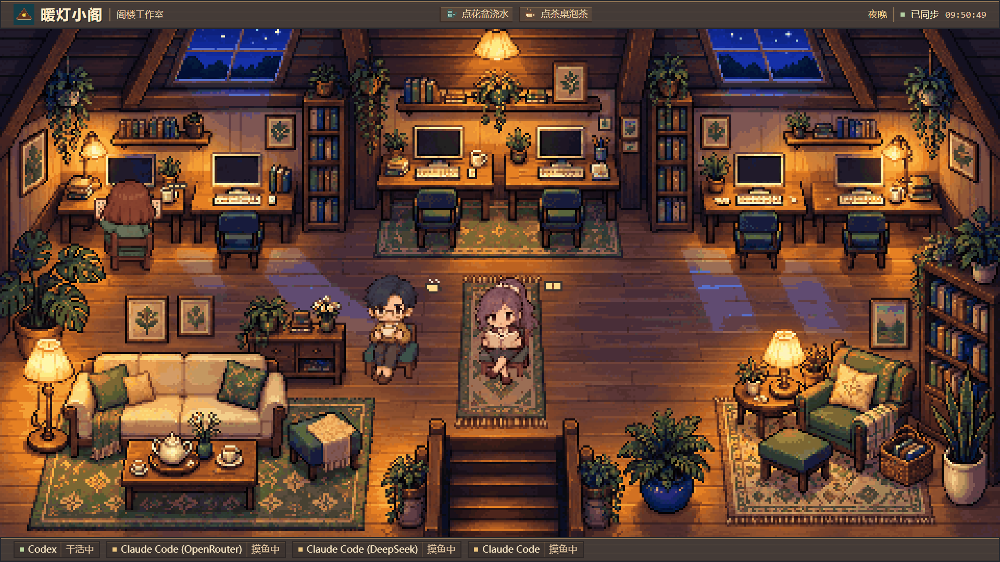

# 暖灯小阁 · AI Office

把本机 AI 编程工具的运行状态，变成一间会工作、会休息的像素阁楼。

## 预览

**白天**


**夜晚**



## 功能特点

- **工具状态可视化**：默认识别 Codex，以及使用 OpenRouter、DeepSeek 或其他服务的 Claude Code。
- **会动的像素伙伴**：干活时回工位敲键盘，空闲时喝茶、看书、打盹；房间最多容纳 6 位伙伴。
- **自动日夜与天气**：按北京时间变化，白天呈现晴、阴、雨、雪，夜晚点亮暖灯。
- **轻松互动**：点击人物打招呼、点击花盆浇水、点击茶桌泡茶。
- **配置即可扩展**：添加工具无需修改前端，状态每 3 秒更新，断线时保留并标记上次状态。

## 快速开始

准备 Git、Python（建议 3.12）和现代浏览器。以下以 **Windows PowerShell** 为例。

### 1. 获取项目

```powershell
git clone https://github.com/Jiang-Xiaoxing/ai-office.git
cd ai-office
```

`git clone` 下载仓库到当前目录下的 `ai-office` 文件夹，`cd` 进入该文件夹。后续命令都在项目目录执行。

### 2. 安装依赖

```powershell
py -m venv venv
.\venv\Scripts\python.exe -m pip install -r requirements.txt
```

`py` 调用已安装的 Python；`-m venv` 创建名为 `venv` 的隔离环境。第二行通过相对路径使用该环境的 Python，`-m pip install` 安装依赖，`-r requirements.txt` 指定依赖清单，安装位置为项目内的 `venv`。

### 3. 启动

```powershell
.\venv\Scripts\python.exe server_app.py
```

这条命令运行网页服务。浏览器打开 **http://127.0.0.1:8889/**，在终端按 `Ctrl+C` 停止。

完成安装后，Windows 也可双击 `start.vbs` 在后台启动，再打开上述地址；双击 `stop.vbs` 停止。

默认只监听 127.0.0.1。

## 配置说明

工具清单位于 [config/tools.json](config/tools.json)。**加一行配置，重启后就多一个像素伙伴和工位，房间最多显示 6 人。**

在 `tools` 数组中追加下面这一项，与前一项用逗号分隔，将 `my-tool.exe` 换成实际进程名：

```json
{ "id": "my-tool", "name": "我的工具", "rules": [{ "type": "process", "names": ["my-tool.exe"] }] }
```

| 字段 | 含义 |
| --- | --- |
| `id` | 唯一工具标识，建议用英文、数字和连字符 |
| `name` | 页面显示的名字 |
| `rules` | 检测规则数组，任意一条命中即显示为干活中 |
| `type` | 检测方式，示例中的 `process` 按进程匹配 |
| `names` | 要匹配的进程名列表，不区分大小写 |

`process` 还可用 `contains_all` 限定命令行关键字、用 `exclude` 排除关键字。另支持 `recent_files`（近期文件活动）和 `claude_session`（按服务区分 Claude Code）；现有配置可作为参考。

保存后重启服务并刷新页面，单独刷新不会重新加载配置。超过 6 个工具时，多余工具仍会在底栏显示。

## 目录结构

```text
ai-office/
├── server_app.py       FastAPI 服务入口
├── detectors.py        工具状态检测与规则校验
├── config/tools.json   工具清单与检测规则
├── static/             网页、像素素材、动画和互动
├── preview/            预览截图
├── docs/               补充文档
├── tests/              自动化检查
├── requirements.txt    运行依赖
└── start.vbs / stop.vbs Windows 后台启停脚本
```

## 工作原理

1. Python 后端通过 `psutil` 读取本机进程信息，按配置中的进程、会话或文件活动规则判断工具状态。
2. 浏览器每 3 秒请求 `/api/status`，获得各工具的 `working`（干活中）或 `idle`（空闲）状态。
3. Canvas 场景让对应伙伴回工位或休息，同时呈现日夜、天气和点击互动。

## 常见问题

**为什么工具一直显示“干活中”？**

状态表示命中了检测规则。默认进程规则在 CLI 存在时就算干活，也包含等待输入的时间；可按需要细化配置中的规则。

**为什么配置了四个工具，画面上只有三个人？**

默认的通用 Claude Code 角色只在检测到无法归属 OpenRouter 或 DeepSeek 的 Claude Code 进程时出现，空闲时隐藏。

**需要填写 AI API Key 吗？**

不需要。项目只展示已有工具的状态，点击人物触发的是预设回应。

**天气是真实天气吗？**

天气是按北京时间变化的场景氛围，不读取真实气象数据。

**页面打不开怎么办？**

先用终端中的启动命令查看报错，确认依赖已安装、8889 端口未被其他程序占用。双击启动时，可查看项目目录下的 `server.log`；仍有问题可提交 [Issue](https://github.com/Jiang-Xiaoxing/ai-office/issues)，附上报错和复现步骤。

## 许可证

暂未指定许可证。
